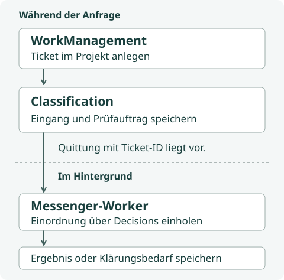

# Architektur und Einstieg in den Code

Falkenwarte ist ein modularer Monolith. Die Fachmodule laufen in einer Symfony-Anwendung und nutzen eine gemeinsame SQLite-Datenbank über Doctrine DBAL. Zur Installation gehören das React-Frontend, FrankenPHP, ein Messenger-Worker und der Wartungsprozess. T3 Code führt externe Agentenaufträge aus. OpenAI Decisions beantwortet Klassifikationsfragen zu eingegangenen Tickets. Im Quellbaum trägt jeder Fachkontext seinen eigenen Namen. Die Context Map beschreibt, welche Regeln und Daten dort liegen. [Fachmodule im Quellbaum](../src/) · [Context Map](domain/CONTEXT_MAP.md)

## Vom Ticketformular zur Fachregel

1. Das Frontend schickt die Ticketdaten an die HTTP-Operation `tasks_create`. Die zulässigen Felder sind in OpenAPI beschrieben. Der TypeScript-Client bezieht seine Typen aus diesem Vertrag. [OpenAPI-Vertrag](../contracts/openapi.yaml)
2. Der HTTP-Einstieg ermittelt den Akteur. Auch ein MCP-Werkzeug, das ein Ticket anlegt, führt seine Operation über das gemeinsame Gateway aus. Das Gateway prüft Berechtigungen, Projektgrenzen und die vom jeweiligen Vertrag geforderten Schreibbedingungen. Ein bereits verwendeter Idempotenzschlüssel mit demselben Auftrag liefert das gespeicherte Ergebnis zurück. [HTTP-Einstieg](../src/Presentation/HttpEndpoint.php) · [MCP-Werkzeug](../src/Presentation/McpTool.php) · [Gateway](../src/Presentation/Gateway.php)
3. Im Kontext WorkManagement vergibt der Handler den Ticketschlüssel, prüft Status und Kriterien und legt das Ticket an. Wer es meldet, entscheidet über den weiteren Weg. Für ein manuelles Ticket kann der Eigentümer die Einordnung selbst setzen. Bei einem technischen Eingang beauftragt WorkManagement über den Port `TaskIntake` den Kontext Classification. [Ticket-Handler](../src/WorkManagement/Application/WorkHandler.php) · [Port für die Eingangsprüfung](../src/WorkManagement/Application/TaskIntake.php)
4. Classification speichert den Eingang und den Auftrag zur Einordnung. Der Aufrufer erhält eine Quittung und kann das Ticket referenzieren, während der Worker die Bewertung einholt. Wie Rückfragen an den Melder und offene Eigentümerentscheidungen entstehen, beschreibt die [Eingangsprüfung mit Decisions](AI_DECISIONS.md).

## Wo eine Änderung hingehört

| Änderung | Einstieg in die Umsetzung |
| --- | --- |
| Fachregel, etwa die Voraussetzungen für einen Ticketabschluss | Die Regel liegt im Fachkontext. Der Application-Handler beschafft die Eingaben und wendet die Regel an. [Abschlussregel](../src/WorkManagement/Domain/TaskCompletionPolicy.php) |
| Zusammenarbeit zwischen zwei Kontexten | Die benötigte Operation wird über eine Schnittstelle ausgedrückt. Für den Zugriff auf aktive Runs einer T3-Verbindung definiert AgentCatalog den Port, Orchestration stellt den Adapter. [Port](../src/AgentCatalog/Application/RunImpactPort.php) · [Adapter](../src/Orchestration/Infrastructure/AgentCatalogRunImpactAdapter.php) |
| Neuer öffentlicher Schreibzugriff | HTTP- oder MCP-Vertrag und zuständigen Handler gemeinsam ändern. Symfony registriert Implementierungen von `OperationHandler` mit einem Service-Tag. Das Gateway findet darüber den Handler. [Container-Konfiguration](../config/services.php) · [Öffentliche Verträge](API.md) |
| Neue Laufzeiteinstellung | Einen sicheren Standardwert in `.env` und die Auflösung im Symfony-Container vorsehen. Der betroffene Service erhält seinen Wert per Dependency Injection. [Konfiguration und Betrieb](operations/DEPLOYMENT_AND_CONFIGURATION.md) |

## Was beim Speichern und im Hintergrund geschieht

Der DBAL-Store schreibt bei einer dokumentierten Objektänderung den neuen Zustand und den Journaleintrag in einer Transaktion. Die Objektgeschichte macht Änderungen am Ticket nachvollziehbar. Ereignisse stehen für die anschließende Auslieferung bereit. Eine Action verbindet den auslösenden Auftrag mit seiner Verarbeitung. [DBAL-Store](../src/Shared/Infrastructure/DbalStore.php) · [Ereignisse und Objektgeschichte](domain/EVENTS.md)

Der Wartungsprozess übergibt fällige Commands an Symfony Messenger. Der Consumer übernimmt den Auftrag anhand seiner ID und vermerkt seine Verarbeitung in der Inbox. Ein externer T3-Aufruf kann wirksam werden, auch wenn die Antwort verloren geht. Deshalb besitzt der Start eines Runs einen eigenen Schlüssel und einen Abgleich mit T3. [Wartungsprozess](../src/Shared/Infrastructure/MaintenanceCommand.php) · [Consumer](../src/Shared/Infrastructure/Consumer.php) · [Start und Abgleich eines Runs](T3_INTEGRATION.md)

## Eine Regel prüfen

Eine Änderung am Ticketabschluss betrifft die Fachregel, den vom Client beobachtbaren Übergang und die Anleitung für Menschen, die das Ticket bearbeiten. Das Fachmodell beschreibt die Bedingung im [Lebenszyklus](domain/LIFECYCLES.md). Der Browserablauf prüft sie an der gestarteten Anwendung. Für eine neue technische Grundsatzentscheidung hält ein ADR die Gründe und Folgen fest. [Tests und QA](TESTING.md) · [Architekturentscheidungen](DECISIONS.md)
