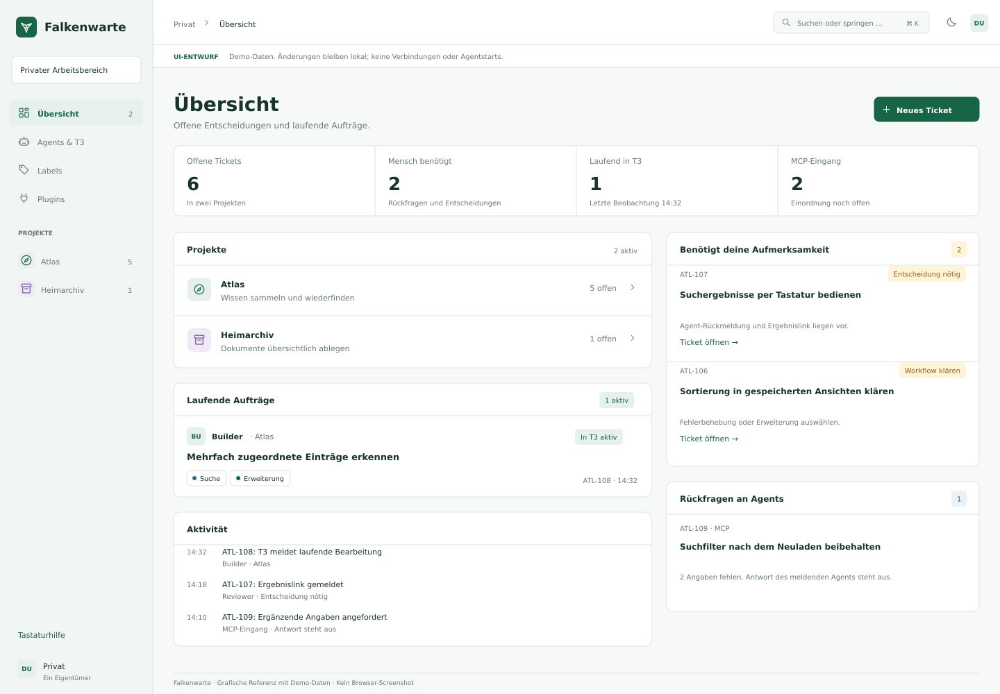
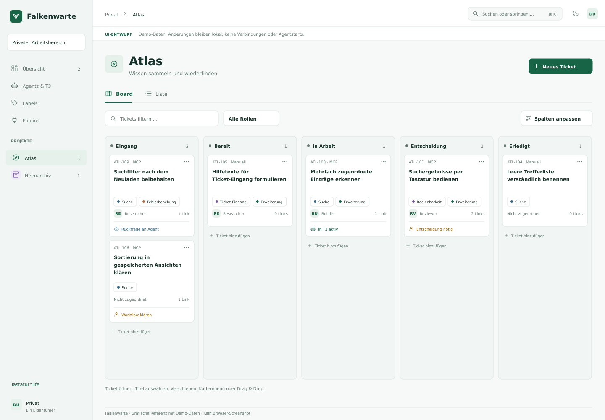
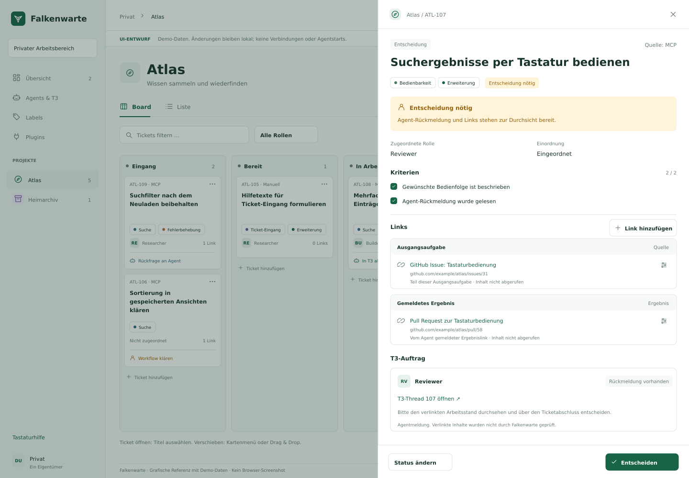
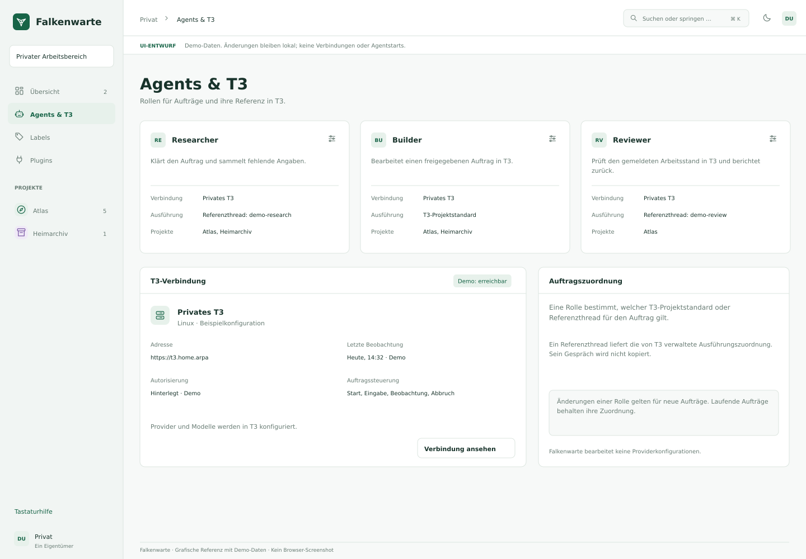
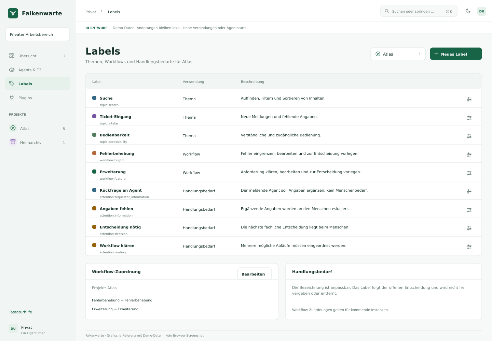

# Visuelle Konzeptreferenzen

**Status:** Diese fünf Layoutbilder stammen aus dem verbindlichen Konzept und zeigen das gewünschte Informationsmodell. Sie sind gezeichnete Referenzen mit Beispieldaten, keine Screenshots und kein Nachweis der aktuellen Anwendung.

Die Implementierung und ihre echten Browserbeobachtungen stehen in [USER_GUIDE.md](USER_GUIDE.md), [ACCEPTANCE.md](ACCEPTANCE.md) und [VALIDATION.md](VALIDATION.md). Bei Abweichungen entscheidet der Fachvertrag; ein Bild schafft keine zusätzliche Produktfunktion.

## Dashboard

## Projektboard

## Ticketdetails

## Agents und T3

## Labels

