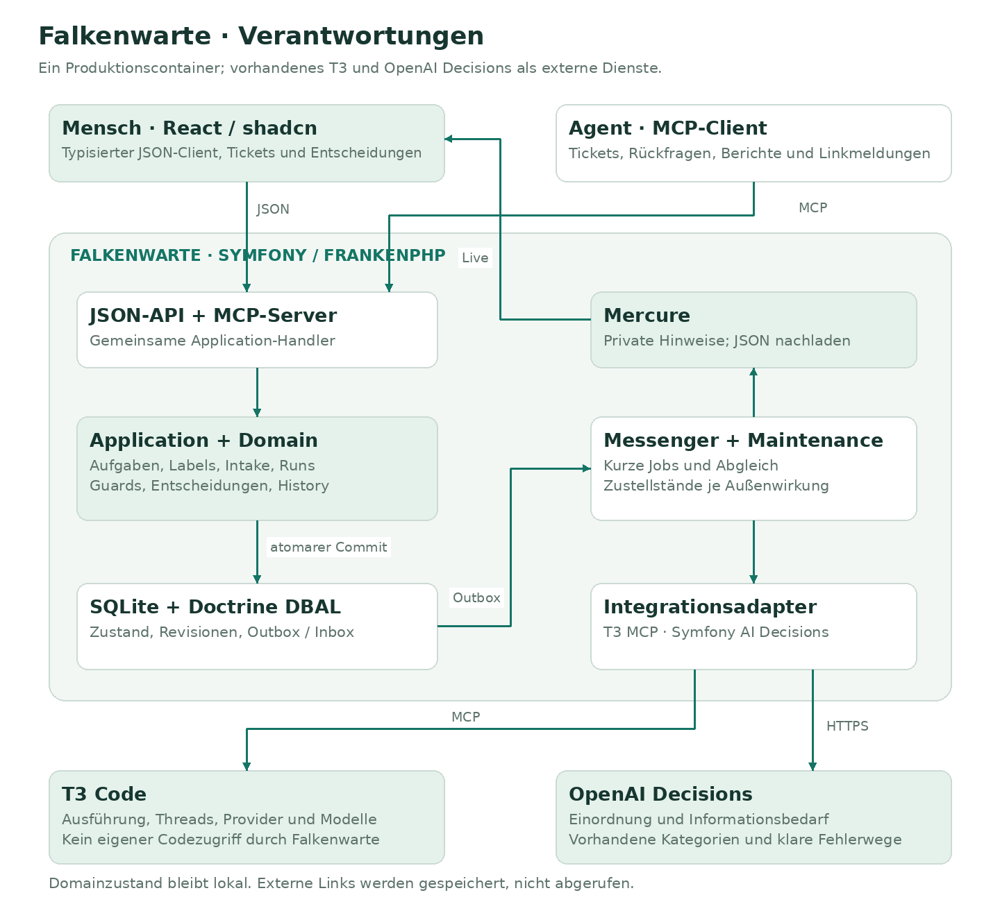

# Falkenwarte

**Status:** Verbindlicher Fachvertrag aus Konzeptfassung 2.0. Der Umsetzungs- und Abnahmenachweis steht in [TRACEABILITY.md](TRACEABILITY.md).

## Projektkonzept für eine private Agent-SDLC-Steuerplattform

**Konzeptfassung 2.0 - 19. November 2026**  
**Zielbetrieb:** Linux, ein menschlicher Eigentümer, ein produktiver App-Container.  
**Basis:** Symfony mit AI-Paketen, Doctrine DBAL, React/shadcn, JSON-API, MCP, FrankenPHP und Mercure.

Falkenwarte verwaltet Aufgaben, deren Einordnung, Agentaufträge und nachvollziehbare Entscheidungen. Die Anwendung steuert eine vorhandene T3-Code-Instanz. T3 besitzt die Provider-, Modell- und Ausführungskonfiguration. Agents liefern Rückmeldungen und Links; Falkenwarte besitzt keinen Zugriff auf den Quellcode der bearbeiteten Projekte.

Dieses Dokument ist der verbindliche Fachvertrag für Konzeptfassung 2.0. Verträge und Mockups präzisieren den gewünschten Funktionsumfang; ihre Implementierung und Abnahme werden getrennt im [Anforderungsnachweis](TRACEABILITY.md) festgehalten.

## 1. Produktumfang und Zuständigkeiten

| Verantwortlicher | Aufgabe |
|---|---|
| Falkenwarte | Projekte, Tickets, Boards, Labels, Intake, Workflows, Rollen, Rückfragen, Link-Collections, History und Metriken |
| T3 Code | Agent-Ausführung, Threads, Provider, Modelle, Zugänge und Arbeitsbereiche |
| Agent | Bearbeitung im eigenen T3-Kontext; Meldung von Ergebnissen, Rückfragen und Links |
| Eigentümer | Fachliche Konfiguration, Entscheidungen und ausdrücklich verlangte menschliche Bestätigungen |
| GitHub für Falkenwarte | Hosting des eigenen Anwendungscodes, Pull Requests, QA und Releases während der Produktentwicklung |

Die Anwendung liest keine Repositories, Diffs oder Testdateien, startet keine CI fremder Projekte und führt keinen Merge durch. Ein GitHub-, GitLab- oder Jira-Link ist eine Referenz. Aus seiner Registrierung entsteht keine Integration zu diesem Dienst. Die GitHub-Pipeline für die Entwicklung von Falkenwarte gehört zur Repository-Infrastruktur; die laufende Anwendung benötigt dafür keinen GitHub-Token.

Die private T3-Umgebung bleibt von der beruflichen Claude-Umgebung getrennt. Falkenwarte verändert weder Codex-Homeverzeichnisse noch Pi-Extensions. Modell- und Provideroptionen werden nicht als eigene Konfigurationsoberfläche nachgebaut.

## 2. Technische Leitentscheidungen

| Bereich | Festlegung |
|---|---|
| Backend | Symfony 7.4 LTS, PHP 8.5.x als recherchierte Ausgangsbasis |
| KI-Entscheidungen | OpenAI Decisions API hinter DecisionGateway; Symfony-AI-Integration in einem eigenen Adapter |
| MCP | Kompatibel fixiertes Symfony MCP Bundle und SDK; eigener Server und T3-Client |
| Persistenz | SQLite, Doctrine DBAL und Migrationen; kein Doctrine ORM |
| Hintergrundarbeit | Messenger, dauerhafte Commands, Outbox, Inbox und kurze geplante Abgleiche |
| Frontend | React, TypeScript, Vite, Tailwind und echte shadcn/ui-Komponenten |
| Client | OpenAPI-generierte Typen, openapi-fetch und TanStack Query |
| Live | Privater Mercure-Hub im FrankenPHP-Prozess |
| Betrieb | Linux, ein App-Service mit persistentem Volume und Prozessaufsicht |
| Produktprüfung | Playwright-E2E; Backend-Funktionstests ausschließlich für Hintergrundaufgaben |
| Entwicklung | GitHub, Conventional Commits, Release Please und verpflichtende PR-QA |

Die konkrete Paketauflösung ist ein M0-Ergebnis. Die Quellenmatrix dokumentiert recherchierte Releasegrenzen, keine bereits erzeugte Lockdatei. Experimentelle AI-/MCP-Pakete werden bewusst fixiert. Eine aktuelle Dokumentation darf nicht ungeprüft mit einem älteren Paketstand vermischt werden.

## 3. DDD und Clean Architecture

Falkenwarte ist ein modularer Monolith. Jedes Fachmodul besitzt Domain, Application, Infrastructure und Presentation. Domain enthält Regeln und Value Objects. Application orchestriert Anwendungsfälle. DBAL, MCP, HTTP und Symfony-Konfiguration implementieren Infrastruktur-Ports. JSON-Controller, MCP-Tools und Console-Adapter rufen dieselben Anwendungsfälle auf.

| Bounded Context | Fachlicher Besitz |
|---|---|
| Portfolio | Projektidentität, Archivierung und T3-Projektzuordnung |
| WorkManagement | Tickets, Kriterien, Abhängigkeiten, Status, Boards und Link-Collections |
| Classification | Labels, Taxonomie, Intake, Entscheidungsbewertungen und Klassifikationsherkunft |
| AgentCatalog | Rollen, T3-Verbindung und Referenzen auf vorhandene T3-Ziele |
| Orchestration | Runs, Auftragsrevisionen, Rückmeldungen, Übergaben und Abgleich |
| Automation | Versionierte Workflows und Label-zu-Workflow-Regeln |
| History | Unveränderliche Objektrevisionen und redigierte Änderungsdarstellung |
| Metrics | Nachvollziehbare Projektionen aus fachlichen Ereignissen |
| Extensions | Plugin-Verträge, aktive Fähigkeiten und Lebenszyklus |
| Access | Eigentümer, technische Principals, Rechte und Secret-Referenzen |

Der kleine Shared Kernel enthält IDs, Clock, ActorRef, Versionen und Ereignisumschläge. Module verändern keine fremden Tabellen. History schreibt als ausdrücklicher Teilnehmer derselben DBAL-Transaktion; lesende Projektionen dürfen später folgen. Queries dürfen spezialisierte DBAL-Lesemodelle verwenden.

Die gemeinsame Sprache, Context Map und Kontextbeziehungen stehen unter docs/domain. Entscheidungen werden als einzelne ADRs unter docs/adr geführt.

## 4. Projekte, Tickets und Boards

Ein Projekt enthält Name, Slug, Icon, Farbe, Beschreibung, Archivstatus und Version. Projektbezogene Ressourcen tragen project_id. Alle Zugänge prüfen diese Zuordnung serverseitig. Archivierung verhindert neue automatische Starts, erhält aber Tickets, offene Aufträge und History.

Ein Ticket enthält Schlüssel, Titel, Beschreibung, Priorität, Status, Kriterien, Abhängigkeiten, Labels, Link-Collections und optionale Rollenwahl. Seine Ursprungsklasse wird aus dem authentifizierten Aufruf bestimmt. Ein technischer Client kann die Pflichtklassifikation nicht durch origin=manual umgehen. Der interne Typname Task darf im Vertrag bleiben; die UI verwendet Ticket beziehungsweise Aufgabe.

Boards sind gespeicherte Sichten auf gemeinsame Tickets. Sie unterstützen Filter, Spalten, sichtbare Felder, Sortierung, Swimlanes und WIP-Grenzen. Fachliche Statuskategorien sind backlog, ready, active, review, done und cancelled. Spaltennamen bleiben konfigurierbar; eine Sammelspalte benötigt einen eindeutigen Dropstatus.

Blockiert, Rückfrage und laufender Agent sind separate Zustände. Das Verschieben einer Karte startet keinen Agenten und bestätigt keinen Run. Eine bereits verwendete Statuskategorie darf Abschlussregeln nicht durch nachträgliche Umklassifizierung umgehen.

Harte WIP-Grenzen werden bei jeder relevanten Änderung gegen alle betroffenen aktiven Boards atomar geprüft. Das gilt für MCP, Listenansichten und filterrelevante Labeländerungen. Verschiedene Boards dürfen eigene manuelle Reihenfolgen derselben Tickets besitzen.

## 5. Konfigurierbare Labels und menschliche Aufmerksamkeit

Ein Label besitzt stabile ID und Key, Name, Farbe, Beschreibung, Art, Aktivzustand und Version. Name, Farbe und Beschreibung sind durch den Eigentümer editierbar. Die Beschreibung dient als Klassifikationskontext. Eine Änderung ihrer fachlichen Bedeutung erhöht die Taxonomieversion.

| Labelart | Bedeutung | Beispiel |
|---|---|---|
| topic | Themenkategorie; eine primäre und weitere passende Kategorien | Suche, Dokumentation, Bedienbarkeit |
| workflow | Zuordnung zu einer konfigurierten Bearbeitungsroute | Fehlerbehebung, Erweiterung, Recherche |
| attention | Systemseitige Ableitung eines Handlungs- oder Wartezustands | Mensch erforderlich, Rückfrage an Agent |

Workflowlabels verweisen über versionierte Routingregeln auf vorhandene Workflows. Sie führen keinen Code aus und verleihen keine Berechtigungen. Mehrdeutige Routen erzeugen Entscheidungsbedarf. Ein aktiver Workflow behält seine Versionsbindung; spätere Labels wechseln ihn nicht unbemerkt aus.

Menschlicher Handlungsbedarf ist ein fachlicher Zustand mit Grund, Zuständigkeit und Auflösungsvoraussetzung. Das Label Mensch erforderlich wird daraus abgeleitet; andere Systemlabels können etwa eine Rückfrage an den Agenten kennzeichnen. Das Entfernen eines sichtbaren Labels kann keine Freigabe erledigen. Mehrere gleichzeitig offene Gründe bleiben getrennt gespeichert.

Eine Rückfrage an den meldenden Agenten bedeutet zunächst waiting_for=requester. Erst eine konkrete Eigentümerentscheidung, Eskalation oder ein fehlender anderer Zuständiger setzt menschlichen Handlungsbedarf. Die UI unterscheidet Rückfrage an Agent und Mensch erforderlich.

Manuell gesetzte Labels behalten ihre Herkunft und werden nicht still durch KI überschrieben. Deaktivierte Labels bleiben in historischen Revisionen lesbar; neue Zuordnungen verwenden nur zugelassene Taxonomiewerte.

## 6. Eingangsprüfung mit OpenAI Decisions

Nicht manuell angelegte Tickets durchlaufen einen dauerhaften Intake. Das gilt für MCP und technische JSON-API-Clients. Ein menschlich erstelltes Ticket kann denselben Vorgang auf Wunsch nutzen. Syntaktisch ungültige Anfragen sind Fehler; fachlich unvollständige Tickets bleiben als nachvollziehbarer Eingang erhalten.

Der Ablauf lautet: Eingang persistieren, Taxonomie und Anforderungsprofil fixieren, Decisions aufrufen, Antwort validieren, Ergebnis auf dieselbe Ticketrevision anwenden und gegebenenfalls Rückfragen erzeugen. Externe Modellaufrufe erfolgen außerhalb der DBAL-Transaktion. Gleichzeitige Ticket-/Taxonomieänderungen werden vor dem Anwenden erkannt.

OpenAI Decisions liefert predicate-, choice- und score-Antworten. Themen und Workflow werden aus freigegebenen Auswahlwerten bestimmt; zusätzliche Labels können als einzelne Prädikate bewertet werden. Die konkrete API-Abbildung und Symfony-AI-Grenze stehen in docs/AI_DECISIONS.md. Grundlage ist die native questions-basierte Richtung des offenen Symfony-AI-PR #2956. Ein eigener enger Symfony-AI-Kompatibilitätsadapter überbrückt fehlende Releaseunterstützung und wird nach einem passenden nativen Release abgelöst.

Vorgesehene Einsatzstellen sind die Themen-/Workflowzuordnung, Prüfung fehlender Angaben, erneute Bewertung nach einer beantworteten Rückfrage sowie das Erkennen unklarer fachlicher Entscheidungen. Für diese Aufgaben wird OpenAI Decisions verwendet, nicht Jev und nicht ein ungeprüfter Responses-Ersatz.

Rückfragen verwenden konfigurierte Feld-/Prüfschlüssel und verständliche Fragevorlagen. Decisions muss keinen freien Rückfragetext erzeugen. Unsichere Antworten, Refusals oder fehlende Ergebnisse liefern keinen erfundenen Erfolg. Providerfehler erhalten begrenzte Retries; ein betroffener Eingang bleibt bestehen und startet keine Arbeit.

MCP liefert ein fachliches Receipt mit Ticket-, Intake- und Action-ID. accepted bedeutet dauerhafte Annahme. needs_information enthält fehlende Angaben und nächste Schritte; ready bedeutet ausreichende Einordnung. Der Client kann den Intake lesen und Angaben nachreichen. Rückfrage ist kein JSON-RPC-Transportfehler.

Modell, Fragen-/Taxonomieversion, Inputrevision, relevante Wahrscheinlichkeiten und angewandte Policy werden nachvollziehbar gespeichert. Wahrscheinlichkeiten sind keine kalibrierte Garantie. Rechte, menschliche Freigaben und Abschlussregeln bleiben deterministisch.

## 7. Link-Collections und Ergebnisrückmeldungen

Ein Ticket kann mehrere benannte Link-Collections besitzen, etwa Quelle, Ergebnisse und Referenzen. Ihre Links enthalten Titel, URL, verpflichtenden Typ und Beziehung, registrierenden Akteur und Zeitstempel. Collections und Links erscheinen in stabiler Erfassungsreihenfolge; neue Einträge werden angehängt.

Beispiele sind das ursprüngliche GitHub-/GitLab-/Jira-Issue eines Teilauftrags, ein vom Agenten eröffneter Pull Request, ein Merge Request oder eine Dokumentationsseite. Mehrere Teilaufgaben können dasselbe Quell-Issue referenzieren.

HTTP-/HTTPS-URLs werden syntaktisch geprüft; ausführbare Schemes, eingebettete Credentials und unzulässige Länge werden abgewiesen. Falkenwarte ruft diese URLs nicht serverseitig ab, erzeugt keine Remotevorschau und prüft keinen PR-Status. Korrigieren und Entfernen werden versioniert und historisiert. Eine zusätzliche manuelle Link-Umordnung gehört nicht zu dieser Fassung.

Ein Agent kann Collections und Links über MCP melden. Er darf keine fremden Projektressourcen zuordnen. Angaben wie Tests erfolgreich bleiben als Agentmeldung erkennbar. Ein Mensch kann sie bestätigen oder zurückweisen. Eine solche Bestätigung bindet auch den damaligen Link-Snapshot; eine neue URL übernimmt keine alte Bestätigung. Diese Entscheidung ist kein unabhängiger technischer Nachweis durch Falkenwarte.

## 8. T3-Verbindung und Agentrollen

Die Verbindung speichert kanonische T3-URL, Secret-Referenz, Authentifizierungsgeneration und Fähigkeiten. Netzwerk-, Authentifizierungs- und Protokollprobleme bleiben unterscheidbar.

Ein Profil beschreibt Rolle, Name, erlaubte Projekte, Verbindung und vorhandene T3-Zielreferenz. Standard ist der T3-Projektstandard. Spezialisierte Ziele können einen vorhandenen Referenzthread verwenden, dessen Ausführungszuordnung der Adapter aus T3 liest. Es gibt keinen Modell- oder Providereditor.

Die tatsächlich gesendete native Payload wird beim Start eingefroren. Im Referenzthread-Modus enthält sie aufgelöste Routingwerte. Beim T3-Projektstandard ohne modelSelection entscheidet T3 erst bei der ersten Annahme über die wirksame Auswahl; Falkenwarte friert hier den Request ein. Ein Replay eines bereits angenommenen Starts erhält dessen gespeicherte T3-Zuordnung. Ist die Referenz nicht mehr auflösbar, wird der Start erklärbar blockiert. Ein Rollenname wie Reviewer ist für sich keine Provider-Berechtigung.

Standardmäßig läuft höchstens ein aktiver Auftrag pro T3-Projektbindung. T3 verantwortet Arbeitsbereiche und Isolation. Falkenwarte führt keine eigenen Repository- oder Worktreeprüfungen durch.

Der Start verwendet t3_thread_launch mit Initialmessage und stabiler clientRequestId. Anschließend wird T3 beobachtet; Agents melden Rückfragen und Resultate über Falkenwartes MCP-Server. Unsicherer Ausgang führt zu passendem Retry oder Reconciliation. OAuth-Erneuerung ist eine mögliche Grenze des Idempotenznamespace.

Die Run-Zustände bilden Annahme, Start, Ausführung, Rückfrage, Authentifizierungsblockade, Abgleich, Abbruch, Ergebnismeldung und Abschluss ab. Der interne Zustand verifying bezeichnet ausschließlich Zuordnungs- und Policyprüfung, keine Codeverifikation. Ein aufgegebener unklarer Run gibt keinen möglicherweise noch belegten Ausführungsplatz automatisch frei.

## 9. Workflow und fachlicher Abschluss

Ein Workflow besitzt versionierte Phasen und deterministische Übergänge. Eine erste Vorlage kann Klärung, Bearbeitung, Reviewmeldung und menschliche Entscheidung enthalten. Nicht jede Aufgabe benötigt alle Phasen.

Die RunCompletionPolicy betrifft nur die aktuelle Phase. Die TaskCompletionPolicy betrifft das gesamte Ticket. Ein Bearbeitungslauf muss den späteren Review auslösen können, bevor dessen Ergebnis vorliegt.

Eine Übergabe enthält Ticketrevision, Zielrolle, Auftrag, Rückmeldungen und erlaubte Links. T3-Threads werden referenziert. Falkenwarte klont kein Repository, wählt keinen Commit durch Codezugriff und übernimmt keine uncommitteten Änderungen.

Menschliche Entscheidungen können wegen unklarer Route, Agent-Rückfrage oder Workflowpolicy verlangt werden. Die UI nennt Grund und konkrete Auflösungsaktion. Decisions kann Bedarf empfehlen, aber keine ausstehende menschliche Zustimmung ersetzen.

Maximale Reparaturrunden, Wartezeiten und Parallelität sind begrenzt. Ein Netzwerkretry zählt nicht als neue Reparaturrunde. Erreichte Grenzen halten den Ablauf nachvollziehbar an.

## 10. Domain Events, Actions und History

Ein Command fordert Änderung an. Domain Events beschreiben tatsächliche fachliche Änderungen. Action Events dokumentieren den Lebenszyklus eines Anwendungsaufrufs. Mercure-Hinweise zeigen betroffene Ressourcen an.

| Ereignisbeispiel | Aussage |
|---|---|
| TicketRegistered | Ein Eingang wurde dauerhaft angelegt |
| TicketClassified | Eine konkrete Taxonomie-/Policyversion wurde angewendet |
| InformationRequested | Ein bestimmter Akteur soll Angaben ergänzen |
| HumanAttentionRequired | Ein menschlicher Handlungsgrund ist offen |
| LinkRegistered | Eine externe Referenz wurde gemeldet |
| RunResultReported | Ein Akteur hat ein Ergebnis behauptet |
| ActionSucceeded | Der lokale Anwendungsfall wurde ausgeführt |

Zustand, Objektversion, redigierter History-Snapshot, Domain Events, Outbox und lokaler Action-Abschluss werden gemeinsam committed. Asynchrone Commands enthalten kanonische Payload, erwartete Version, Akteur und Deduplizierungsidentität dauerhaft. Inbox-Marker und lokale Consumerwirkung sind ebenfalls atomar.

HTTP-Aufrufe zu T3, Decisions und Mercure erfolgen außerhalb der Fachtransaktion. Verschiedene Außenwirkungen besitzen getrennte Zustellstände. History-Restore erzeugt eine neue Revision und macht externe Agent-Arbeit nicht rückgängig.

Snapshots und Events sind versionierte Daten, keine serialisierten PHP-Objekte. Secrets und rohe Authorization-Header werden nicht historisiert. Projektions-Rebuilds dürfen keine Agentstarts auslösen.

## 11. Persistenz mit DBAL

Migrationen erzeugen explizite Tabellen, Constraints und Indizes. Repositories rekonstruieren Aggregate; Queries verwenden parametrisierte Abfragen und freigegebene Filter. ORM-Mappings und EntityManager gehören nicht zum Produkt.

Die fachlichen Datenfamilien umfassen Projekte, Tickets/Kriterien/Abhängigkeiten, Boards/Positionen, Labels/Zuordnungen/Taxonomieversionen, Intake/Decision-Bewertungen, Link-Collections/Links, menschliche Handlungsgründe, T3-Verbindungen/Rollen, Runs/Versuche/Beobachtungen, Workflows/Routingregeln, Actions, Domain Events, Objektrevisionen, Outbox/Inbox, Metriken, Plugins und technische Zugänge. Das benennt logische Besitzbereiche und behauptet keine einzelne SQL-Tabelle pro Aggregat.

**Implementierungsstand:** Die erste DBAL-Migration speichert versionierte Ressourcen in `records(type,id,project_id,data)`, wobei `type` den Ressourcentyp markiert und `data` gültiges JSON enthält. `revisions`, `events`, `commands` und `inbox` bleiben getrennte Tabellen; die Migration ergänzt außerdem Deduplizierung, Sitzungen, Secrets, Runtime-Status und Messenger-Nachrichten. Das ist das aktuelle physische Schema und kein Nachweis, dass jede im Konzept genannte Funktion vollständig implementiert ist.

Optimistische Versionen verhindern stilles Überschreiben. WIP, Abhängigkeitszyklen und Ausführungsplätze verwenden gemeinsame Scope-Versionen oder atomare Reservierungen. Nach SQLite-Busy wird die lokale Prüfung begrenzt wiederholt; externe Wirkungen gehören nicht in diese Wiederholung.

SQLite liegt im persistenten Volume auf lokalem Linux-Dateisystem. WAL, foreign_keys, busy_timeout und Dauerhaftigkeit werden bewusst eingerichtet. Die tatsächlich geladene Bibliothek und benötigte Fehlerkorrekturen werden im Image nachgewiesen.

## 12. JSON-API und MCP-Parität

Alle menschlichen Produktfunktionen sind per versionierter JSON-HTTP-API erreichbar. Damit wird keine automatische Umsetzung der eigenständigen JSON:API-Spezifikation behauptet. Feldformen stehen in contracts/openapi.yaml.

Mutationen verwenden Idempotenzschlüssel; vorhandene Aggregate zusätzlich konkrete erwartete Versionen. Deduplizierung umfasst Principal, Operation, Ziel und normalisierten Inhalt einschließlich Version. Replays prüfen Berechtigungen erneut. Fehlende Preconditions, veraltete Versionen und fachliche Konflikte bleiben unterscheidbar.

Asynchrone Aufrufe liefern Action-/Intake-/Run-Referenzen. Berechtigte Clients können diese nachverfolgen und müssen nicht den letzten Run einer Aufgabe erraten.

MCP verwendet dieselben Application-Handler. Intake, Labels, Links, Versionen und Projektgrenzen gelten identisch. Agent-Tools dürfen keine Eigentümerfreigaben ausstellen und keine Secret-/Pluginadministration übernehmen. Rückfragen sind strukturierte fachliche Ergebnisse.

## 13. Oberfläche und Client-Pattern

Komponenten rufen Feature-Hooks, den typisierten API-Client und anschließend JSON auf. OpenAPI erzeugt TypeScript-Typen; TanStack Query verwaltet Serverdaten. UI-Zustand bleibt auf Auswahl, Dialoge und ungespeicherte Eingaben begrenzt.

| Ansicht | Sichtbarer Zweck |
|---|---|
| Dashboard | Offene menschliche Entscheidungen, laufende Aufträge und Projekte |
| Projektboard/Liste | Gemeinsame Tickets, Filter, Labels und Bearbeitungsstand |
| Ticket-Sheet | Beschreibung, Kriterien, Rückfragen, Links, Runs und Verlauf |
| Labels | Name, Farbe, Beschreibung, Art und Workflowzuordnung |
| Rollen und T3 | Rollenverwendung, vorhandene Zielreferenzen und Verbindungszustand |
| Plugins | Installierte Fähigkeiten, Aktivierung und laufende Deaktivierung |
| Dokumentation | Produktwissen, Fachmodelle, Entscheidungen und Bedienung |

Es gibt keine Produktansicht für Code, Diffs, Builds, Providerwahl, Codex-Homes oder erfundene Testnachweise. Links erhalten keinen automatisch ermittelten PR-/Issue-Status. Kein Button verspricht eine nicht entwickelte Integration.

Projektfarben werden mit Text und Icon kombiniert. Aufmerksamkeit besitzt Grund und nächste Aktion. Drag-and-drop hat eine Menü-/Tastaturalternative. Konflikte laden den aktuellen Stand und erhalten ungespeicherte Eingaben soweit möglich.

shadcn-Komponenten, neutrale Flächen, Tabellen und konsistente Fokuszustände prägen das Design. Die Mockups zeigen ausschließlich den beschriebenen Umfang mit klar gekennzeichneten Demo-Daten.

## 14. Live-Dienste

Mercure läuft im FrankenPHP-Prozess. Ein privater Subscriber-Cookie autorisiert den Browser für seine Topics. Publisher-Schlüssel und T3-/OpenAI-Zugänge bleiben im Backend.

Der Outbox-Publisher sendet nach Commit über HTTP an den Hub. Der Browser erhält Ressourcenkennung und Version, invalidiert Queries und lädt JSON nach. Nach jedem Verbindungsaufbau oder Reconnect wird ein Snapshot angefragt. Der Replaypuffer ist keine Domain-History.

Hub, Mercure-Component und Bundle werden zusammenpassend fixiert. Alte und moderne Authentifizierungsbeispiele werden nicht vermischt. Details stehen in docs/LIVE_SERVICES.md. Ein ausgefallener Live-Kanal beschädigt keine dauerhafte Aufgabenarbeit.

## 15. Plugins und Bridges

Aktive externe Ports sind AgentExecutionBridge für T3 und DecisionGateway für OpenAI Decisions. Ein UI-Change-Publisher kapselt Mercure. Eine zusätzliche Bridge benötigt eine ausdrücklich gewählte Pluginfunktion.

Das Zielprodukt implementiert keine RepositoryBridge, IssueTrackerBridge oder Remote-Test-Verifikation. Ein späterer Vorschlag dafür benötigt eine neue Scope-Entscheidung mit ADR.

Installierte Plugins registrieren typisierte Fähigkeiten, UI-Slots, Subscriber, Metriken oder zusätzliche deterministische Regeln. Deaktivierung sperrt neue Arbeit und lässt vorhandene nach definierter Policy auslaufen. Historische Daten bleiben lesbar. Neuer PHP-/React-Code gelangt durch einen kontrollierten Image-Build in das Produkt; vorhandene Fähigkeiten können zur Laufzeit aktiviert werden.

## 16. E2E-Teststrategie und Fixtures

Die produktweite Laufzeitabdeckung besteht aus Playwright-E2E gegen eine gestartete Falkenwarte. Browser-, JSON- und MCP-Zugänge werden über ihre echten Schnittstellen geprüft. Unit-, Component- und allgemeine Backend-Funktionstests werden nicht eingeführt.

Die einzige Ausnahme sind Backend-Funktionstests für Hintergrundaufgaben: Messenger, Outbox, Reconciliation, Scheduler und Decisions-Jobs. Die Ausnahme wird nicht auf Domain- oder Controllerprüfungen ausgedehnt.

E2E verwendet echte DBAL-Persistenz, Worker und Mercure. Ein zustandsbehafteter T3-MCP-Mock und ein Decisions-HTTP-Mock ersetzen externe Dienste. Ein Agent-Simulator ruft den echten Falkenwarte-MCP-Server auf. Browserroute-Mocks allein decken ausgehenden PHP-Verkehr nicht ab.

Deterministische Fixtures beschreiben Projekte, Labels, Rollen, Tickets, Links, Rückfragen und Fehlerzustände. Läufe erhalten getrennte Daten und Mockzustände. Die konkrete Strategie und Bereinigung stehen in docs/TESTING.md und qa/.

Formatter, PHPStan, TypeScript-, Schema-, Dokumentations- und Abhängigkeitsprüfungen bleiben statische QA. Abdeckung meint fachliche E2E-Szenarien; eine Unit-Zeilenquote wird nicht verlangt.

## 17. GitHub und Releases

Das Falkenwarte-Repository liegt auf GitHub. Pull Requests durchlaufen statische QA, Build, E2E und gegebenenfalls die erlaubten Background-Funktionstests. Erforderliche Checks besitzen auch bei bedingten Jobs einen eindeutigen Gesamtstatus.

Conventional Commits und eine konsistente Squash-Merge-Regel bilden die Grundlage für Release Please. Release-PRs aktualisieren Version und Changelog. Veröffentlichung verwendet einen überprüften unveränderlichen Commit. Der Umgang mit tokenbedingter Workflowauslösung steht in docs/GITHUB_DELIVERY.md.

Die App-Laufzeit erhält keine Repository-Schreibrechte. Containerveröffentlichung ist ein Entwicklungs-/Releasevorgang. Das Aktualisieren der privaten Installation bleibt ein dokumentierter Betriebsschritt.

## 18. Nachhaltige Fachdokumentation

Dokumentation wird mit dem Produkt versioniert und gehört zu derselben Änderung. Der Bereich enthält einen menschlich lesbaren Einstieg, gemeinsame Sprache, Context Map, Bounded Contexts, Aggregate/Invarianten, Lebenszyklen, Eventkatalog, ADRs, Benutzerabläufe und Betrieb.

Ein statischer Bereich wird beim Build erzeugt und ohne Zusatzdienst unter /docs bereitgestellt. Er enthält freigegebene Produktdokumentation, keine Zugangsdaten. Markdown bleibt im Repository lesbar. Ein getrenntes Wiki wird nicht vorausgesetzt.

Jede Änderung an Fachregel, Zustand, öffentlichem Vertrag oder Modulgrenze benennt betroffene Dokumente und E2E-Fälle. ADRs werden durch neue Entscheidungen ersetzt und nicht rückwirkend umgedeutet. docs/DOCUMENTATION.md definiert Pflege, Vorlagen und Drift-Prüfungen.

## 19. Linux-Betrieb und Restore

Ein Produktions-Compose enthält genau einen Falkenwarte-App-Service. Das Image enthält Backend, gebaute UI und Dokumentation. Ein Supervisor überwacht FrankenPHP, Consumer und Maintenance. T3 ist extern vorhanden. Ein Test-Compose darf zusätzliche Mock-/Testdienste enthalten.

Daten, TLS-Zustand und Backups liegen persistent; Anwendungscode im Image. Secrets werden getrennt eingebracht. Migrationen laufen unter Sperre vor Workern. Prozess-/Schemafehler beeinflussen Readiness; T3-/OpenAI-Ausfälle sind Verbindungszustände.

Healthchecks ersetzen keine Prozessaufsicht. Kurze Jobs und dauerhafte Commands ermöglichen Wiederanlauf. Backups verwenden einen konsistenten SQLite-Mechanismus. Nach Restore werden auch mögliche T3-Starts seit dem Backup inventarisiert, bevor neue automatische Starts erlaubt sind.

Kanonische HTTPS-Adressen müssen aus Browser, Container und Agentumgebung erreichbar sein. Linux-Routing und CA-Vertrauen werden dokumentiert. Windows- und WSL-Kompatibilität gehören nicht zum Umfang. Details stehen in docs/OPERATIONS.md.

## 20. Metriken mit erkennbarem Ursprung

Das Dashboard zeigt offene Tickets, menschlichen Handlungsbedarf, wartende Rückfragen und laufende T3-Aufträge. Projektmetriken umfassen Durchsatz, Lead-/Cycle-Time, Blockade-/Wartezeiten, Intake-Ergebnisse, Routingkorrekturen und Run-Ausgänge.

Jede Kennzahl hat Definition, Zeitraum, Stichprobe und Datenstand. Run-Ausgänge basieren auf T3-Beobachtung und gültiger Rückmeldung, nicht auf Codeprüfung. Gemeldete Tests werden nicht zu einer eigenen Codequalitätsstatistik umgedeutet.

Es gibt keine erfundene Modellbudget- oder Kontingentanzeige. Tatsächlich gemeldete Decisions-Nutzung kann in einer Diagnose erfasst werden. Private T3-Providerabrechnungen werden nicht als verfügbare Datenquelle vorausgesetzt.

## 21. Umsetzungsmeilensteine

| Meilenstein | Verbindliches Ergebnis |
|---|---|
| M0 | Paketmatrix, Dokumentationsstruktur, GitHub-QA-Grundlage, Verträge, Mockprofil und Linux-Containerbasis |
| M1 | Menschliche Ticketarbeit mit Projekten, Labels, Links, Boards, History und shadcn; erste E2E-Abläufe |
| M2 | MCP-Server, technischer Intake, OpenAI Decisions, Rückfragen und versioniertes Routing |
| M3 | T3-Bridge, Zielreferenzen, Start, Eingabe, Ergebnismeldungen, Übergaben und Wiederaufnahme |
| M4 | Workflows, menschliche Entscheidungen, Live-Verhalten und Metriken |
| M5 | Plugin-Lebenszyklus, scopekonformes Beispielplugin und vollständig zugeordnete Fachdokumentation |
| M6 | Release Please, Imageveröffentlichung, Backup/Restore, Ausfall-E2E und Betriebsanleitung |

Jeder Schritt liefert nutzbares Verhalten samt Dokumentation. Fehlende produktive Zugangsdaten blockieren den Aufbau gegen Mocks nicht. Echte Integrationsnachweise bleiben ausdrücklich offen und werden nicht durch erfundene Verbindungen ersetzt.

## 22. Definition of Done

Alle Anforderungen in requirements.json sind auf Konzept, Verträge und Abnahmefälle abgebildet. Menschliche UI, JSON und MCP verwenden identische Fachregeln. Providerkonfiguration und Codezugriff bleiben außerhalb Falkenwartes. Intake, Labels, Links und menschlicher Handlungsbedarf sind konsistent. E2E-Mocks und Fixtures, Linux-Ein-Container-Betrieb, Restore und Releaseablauf sind nachgewiesen.

GOAL.md enthält den aktualisierten Coding-Auftrag. docs/CHANGELOG.md erklärt die Änderungen. VALIDATION.md unterscheidet tatsächlich ausgeführte Artefaktprüfungen von zukünftigen Produktnachweisen.
