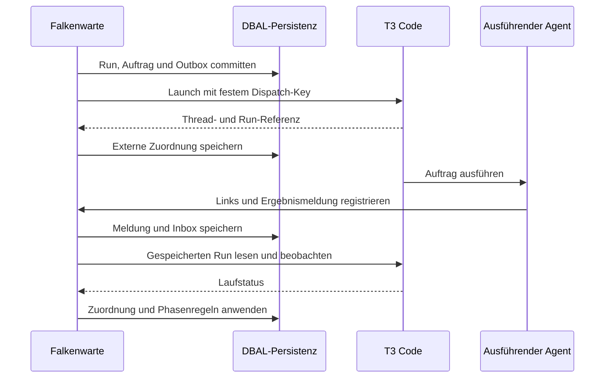

# T3-Integration: Aufträge, Rückmeldungen und Wiederaufnahme

**Stand:** 19. November 2026. **Recherchierte T3-Basis:** `v0.1.10`, Commit `7d32075e3757ded707914e2450c3e392a9665765`.

Dieses Dokument spezifiziert die `AgentExecutionBridge`. Aussagen zu nativen T3-Verträgen beruhen auf dem Release-Quellcode; Falkenwarte-Zustände, Persistenz und Freigaberegeln sind eigene Entwurfsentscheidungen. Ein Lauf gegen die konkrete Installation bleibt ein Implementierungsgate. Das Konzept behauptet keinen bereits ausgeführten Produktnachweis.

Falkenwarte verwaltet Aufgaben und steuert eine vorhandene T3-Instanz. Es mountet keine Entwicklungsrepositories, führt keine Git-/Shell-/Testbefehle aus, verwaltet keine Worktrees und erhält keinen Docker-Socket. Eine Agentmeldung über Tests oder einen Pull Request bleibt eine Meldung. Die fachliche Annahme einer Meldung und die Bestätigung durch den Eigentümer sind ausdrücklich unterscheidbar.

## 1. Zwei MCP-Richtungen

Der **MCP-Client** von Falkenwarte startet und beobachtet T3-Threads über die `AgentExecutionBridge`. Der **MCP-Server** von Falkenwarte stellt Agenten Aufgaben, Kontext, Linkregistrierung und Ergebnismeldung bereit. `runs_report_result` meldet einen Ergebniskandidaten; der Application-Handler entscheidet über seine zulässige Zuordnung.

Credentials beider Richtungen bleiben getrennt. Agent-Principals bekommen auf Projekte und Fähigkeiten beschränkte Falkenwarte-Tokens, niemals den Falkenwarte→T3-Bearer. Die berufliche Claude-Umgebung wird nicht angeschlossen. Ein separat laufendes Pi kann Falkenwarte-MCP verwenden; daraus folgt keine behauptete Pi-Provider-Unterstützung in T3. Die Ausführung durch T3 setzt eine dort tatsächlich unterstützte und konfigurierte Laufzeit voraus.

Das Frontend spricht ausschließlich die Falkenwarte-JSON-API an. T3s allgemeine HTTP-/WebSocket-RPC-Fläche ist nicht der Integrationsweg: Die recherchierte MCP-OAuth-Audience ist dort ungültig. Native ausgehende Completion-Webhooks werden nicht vorausgesetzt. [Q4]



Eine Agentmeldung kann die Launch-Antwort überholen. Deshalb trägt der Auftrag bereits die interne Run-/Versuchsreferenz; die Inbox nimmt eine autorisierte Meldung auf und wartet bei noch fehlender externer Zuordnung. Unbekannte Fremdversuche werden nicht anhand eines ähnlichen Titels zugeordnet.

## 2. Verbindung auf Linux

### 2.1 Client und Protokollprofil

Die Umsetzung sperrt `symfony/mcp-bundle:1.0.0-BETA1` mit `mcp/sdk:0.9.0`; ein Upgrade auf SDK 0.10 wird nicht allein wegen seiner Aktualität angenommen. Der Falkenwarte-MCP-Server wählt `2025-06-18`, deaktiviert die moderne Protokollära und implementiert Werkzeuge über das SDK-`ToolHandlerInterface` mit `StreamableHttpTransport`. Der ausgehende T3-Client setzt dieselbe Protokollrevision, deaktiviert Fallback und prüft die ausgehandelte Version; SDK-Typen bleiben hinter `AgentExecutionBridge`.

T3s geprüfter HTTP-Server nennt zwei Protokollprofile: `2025-06-18` und `2026-07-28`. Das erste nutzt den klassischen `initialize`-Ablauf; das zweite den neueren stateless `server/discover`-Ablauf. Diese Profile dürfen in Fixtures oder Clientimplementierung nicht vermischt werden. [Q10]

**MVP-Baseline ist `2025-06-18`.** Der implementierte T3-Client legt diese Version explizit fest und verwirft eine abweichende Aushandlung; der Falkenwarte-Server begrenzt sich auf denselben Legacy-Handshake. Das neuere Profil `2026-07-28` bleibt gesperrt, bis eigene Implementierung und Fixture-Nachweis vorliegen. Die SDK-API-Auswahl und lokale Protokollkonstruktion sind geprüft; ein Handshake mit der aktiven T3-Instanz bleibt offen.

`tools/list`, benötigte Toolnamen und Antwortschemata werden nach der Verbindung geprüft. Neben HTTP-/JSON-RPC-Fehlern ist auch MCP `isError:true` ein Fehler. JSON-Antwort und gegebenenfalls SSE-Transport werden gemäß dem gewählten Profil verarbeitet; HTTP 200 allein bedeutet keinen Erfolg.

### 2.2 OAuth

Ein eigener `T3OAuthAuthenticator` verwendet Symfony HttpClient für Discovery, Registrierung, PKCE und Codeaustausch. Automatisches OAuth durch das gewählte SDK wird nicht vorausgesetzt. Der MCP-Transport erhält anschließend den serverseitig verwahrten Bearer.

T3 bietet öffentliche OAuth-Clients ohne Client-Secret, Authorization Code und PKCE `S256`. Discovery liegt unter `/.well-known/oauth-protected-resource/mcp`. Die Metadaten benennen Registrierungs-, Authorize- und Token-Endpunkt. Im recherchierten Release ist ein Code einmalig und 60 Sekunden gültig; ein Token gilt 30 Tage. Ein Refresh-Token-Grant ist dort nicht vorhanden. [Q3, Q5]

1. Kanonische T3-Resource konfigurieren; Metadaten abrufen und erwarteten Issuer prüfen.
2. Einen festen Redirect registrieren. Zufälligen `state` und PKCE-Verifier mit kurzer Frist serverseitig speichern.
3. Den Eigentümer zur entdeckten Authorization-URL führen. Er genehmigt die benötigte operative Berechtigung und das T3-Runtime-Ceiling.
4. Callback gegen `state`, Issuer und Redirect prüfen; Code sofort austauschen.
5. Token verschlüsselt, Ablaufdatum und eigene `auth_epoch` speichern. Codes, Verifier und Authorization-Header nicht loggen.
6. Vor Ablauf erneute Anmeldung ermöglichen; danach `auth_epoch` erhöhen und offene Zuordnungen abgleichen.

Read-only umfasst `orchestration:read`; operative Grants ergänzen `orchestration:operate` und ein signiertes Runtime-Ceiling. Toolargumente dürfen diese Grenze nicht erhöhen. Eine Falkenwarte-Rollenbezeichnung ist keine Garantie tatsächlicher T3-Berechtigungen. [Q4]

### 2.3 Kanonische Adressen

Browser und Linux-Container verwenden dieselbe kanonische HTTPS-T3-Adresse, etwa `https://t3.home.arpa`. Falkenwarte kann unter `https://falkenwarte.home.arpa` erreichbar sein. Diese Namen sind Konfigurationsbeispiele: DNS, TLS und erreichbarer Callback müssen in der Installation eingerichtet werden. Intern darf DNS anders routen; URL, Host und Issuer bleiben konsistent. Zertifikate werden regulär validiert.

T3 bindet den Authorization Code an die aus dem Request abgeleitete Resource. Unterschiedliche T3-Origins zwischen Browser-Autorisierung und serverseitigem Austausch sind daher kein zulässiger Standard. Der Falkenwarte-Callback darf eine eigene Origin haben; der recherchierte Vertrag erlaubt HTTPS oder HTTP-Loopback. Für einen Browser auf einem zweiten Rechner ist eine erreichbare HTTPS-Adresse nötig. [Q3]

T3 `/mcp` verweigert im geprüften Release einen Browser-`Origin`-Header mit 403. Deshalb verbindet sich der Browser nicht direkt mit T3-MCP. Der Agent→Falkenwarte-Rückweg benutzt den separat erreichbaren Falkenwarte-MCP-Endpunkt und dessen Credentials. [Q10]

## 3. Agentprofile sind Rollen und T3-Referenzen

Ein `AgentProfile` beschreibt Rolle, Auftragshinweise, zulässige Projekte, Verbindung und Auswahl einer **T3-eigenen Ausführungskonfiguration**. Es enthält keine Modell-, Provider-, Codex-Home-, Skilldatei- oder Workspace-Editoren.

| `execution_target` | Verhalten |
|---|---|
| `{ "mode": "t3_project_default" }` | Launch ohne eigenes `modelSelection`; T3 löst seinen effektiven Projektstandard bei erstmaliger Annahme auf. Kann T3 kein zulässiges Ziel ermitteln, wird der Start sichtbar blockiert. |
| `{ "mode": "t3_reference_thread", "reference_thread_id": "…" }` | Vorhandenen Referenzthread im gebundenen T3-Projekt lesen; belegte Routingfelder für einen neuen Thread übernehmen. |

Der zweite Modus benötigt tatsächlich lesbare, passende `providerInstanceId`- und `model`-Felder aus `t3_thread_read`. Der Launchvertrag nennt dieselbe Instanz `modelSelection.instanceId`. Diese Übersetzung ist ausschließlich Adapterarbeit. Im geprüften Thread-Detail fehlen vollständige Provideroptionen; Falkenwarte behauptet deshalb weder vollständiges Klonen einer T3-Konfiguration noch Kopieren von Skills, Berechtigungen oder Gesprächsverlauf. Vom Referenzthread gelesene Modi werden nur übernommen, wenn sie im aktuellen Grant zulässig sind. Fehlen nötige Felder oder passt das Projekt nicht, folgt ein erklärter Blocker. [Q2, Q11]

Der native Request wird als unveränderlicher Dispatch-Snapshot gespeichert. Beim Referenzthread-Modus enthält er die zuvor gelesenen Routingwerte; eine spätere Änderung dieses Threads verändert den Retry nicht. Beim Projektstandard wird dagegen bewusst kein `modelSelection` übertragen: Eingefroren ist das Requestpayload, nicht eine vorweggenommene effektive T3-Auswahl. T3 löst seinen aktuellen Standard bei erstmaliger Annahme auf. Ändert sich dieser vor der ersten Annahme, kann auch die verwendete Auswahl abweichen. Nach bereits angenommenem Launch verwendet der native Replay den gespeicherten `launchedModel`-Wert. Falkenwarte speichert die tatsächlich zurückgemeldete Zuordnung, ohne einen eigenen Modellkonfigurator einzuführen. Ein neuer bewusster Versuch erhält einen neuen Snapshot. [Q8]

**Pro `ProjectBinding` läuft zunächst höchstens ein aktiver Run.** Die Workspaceverantwortung liegt vollständig bei T3. Ein späteres Parallelitätsfeature benötigt eine nachgewiesene T3-Isolierungsfähigkeit und ein eigenes ADR; der erste Produktumfang erfindet keine eigene Prüfung von Arbeitskopien.

## 4. Native Operationen für das Ping-Pong

| Werkzeug | Genutzter Zweck |
|---|---|
| `orchestrator_capabilities` | Verfügbare Fähigkeiten und zulässige Routingreferenzen prüfen; keine zweite Providerverwaltung aufbauen. |
| `t3_project_list` | Ein vorhandenes Projekt mit `cursor` und `limit` auswählen. |
| `t3_thread_launch` | Neuen Auftrag mit `projectId`, `title`, `message` und `clientRequestId` starten. |
| `t3_thread_read` | Threadrouting, Nachrichten und beobachtete Runs lesen; Cursor fortsetzen. |
| `t3_thread_wait` | Bekannten Run beobachten; ein Timeout ist kein Abbruch. |
| `t3_thread_send` | Gezielte Fortsetzung mit stabiler Dispatch-ID und `mode:"queue"`. |
| `t3_thread_interrupt` | Gewünschten Stop anfordern und anschließend Wirkung beobachten. |

Diese Namen und Argumentformen stammen aus dem geprüften nativen Vertrag. Allgemeine Fähigkeiten externer Clients unterscheiden sich von den nur intern verfügbaren Delegationswerkzeugen. `delegate_task` und `create_threads` werden nicht als externer Orchestrierungseinstieg vorausgesetzt. [Q1, Q2, Q4]

### Initialer Start

```json
{
  "projectId": "existing-t3-project-id",
  "title": "Falkenwarte FW-104 · Versuch att-001",
  "message": "Bearbeite den eingefrorenen Auftrag für Run run-001, Versuch att-001, Dispatch dsp-001. Lies Kontext über Falkenwarte-MCP. Registriere Ergebnislinks und melde den Ergebnisstand mit runs_report_result.",
  "clientRequestId": "dsp-001"
}
```

Dies ist ein illustrativer nativer Request mit Platzhalter-IDs für den Modus `t3_project_default`. Die Clientnachricht enthält keine Secrets. Beim Referenzthread-Modus ergänzt ausschließlich der Adapter die aus der aktuellen T3-Antwort aufgelösten Routingfelder.

Direkter Launch mit Initialmessage ist der Standard. T3 bereitet den eigenen Ausführungskontext vor dem Agentstart vor. Ein leerer Launch und ein unmittelbar nachfolgender Send würden eine unnötige zusätzliche Abstimmung erzeugen. Die Antwort enthält Thread-/Projektreferenzen und bei einem gestarteten Turn die Runreferenz; die validierte Zuordnung wird gespeichert. [Q1, Q6]

### Beobachtung

`read`-Polling alle 3–10 Sekunden mit Jitter und Backoff genügt für die kleine Installation. Ein `wait` kann die Beobachtung ergänzen; der native Default beträgt 30 Sekunden, das Maximum 45 Sekunden. Der einzige Dispatch-Worker wird nicht durch lange blockierende Waits belegt. Kurze, erneut planbare Beobachtungsjobs oder ein begrenzter eigener Observer im selben Container erhalten die Reaktionsfähigkeit. [Q7]

Nachrichten werden mit `afterPosition`, `limit`, `runLimit` und `maxCharsPerItem` gelesen. Laut Vertrag sind höchstens 100 Items, 50 Runs und 20000 Zeichen pro Item erlaubt. Textfortsetzungen benutzen `itemId` und `textOffset`. Ein Positionscursor allein ist kein Änderungsfeed: Aktive Items können sich verändern und werden bis zum Turnende erneut gelesen. Native Restart-Fortsetzungen können andere Run-IDs erzeugen; ursprüngliche Dispatch-Run-ID und beobachtete Ergebnis-Run-ID bleiben getrennt. [Q2, Q7]

Ein Folgeauftrag benutzt `t3_thread_send`, eine neue Dispatch-ID und eine eingefrorene Nachricht. `mode:"queue"` ist der bewusste Default. Ein `auto`-Send kann in laufende Arbeit eingreifen und wird deshalb nicht unbeachtet gewählt. Der nächste spezialisierte Rollenauftrag beginnt normalerweise als neuer, korrelierter T3-Thread; der fachliche Handoff besteht aus gespeicherten Aufgabenangaben, gemeldeten Ergebnissen und registrierten Links. Ein referenzierter Link wird nicht automatisch geladen.

## 5. Idempotenz und Persistenz

`clientRequestId` für Launch ist bereits in v0.1.10 durch Schema, Handler und die dortigen Upstream-Prüfungen belegt. Falkenwarte nutzt die Funktion; es implementiert dafür keinen T3-Fork. [Q1, Q8]

T3 leitet IDs aus `[requestNamespace, clientRequestId]` ab. Externe Clients haben den Namespace `client:<OAuth-sessionId>`. Eine Wiederholung unter derselben OAuth-Session kann dadurch vorhandene IDs wiederverwenden. Eine neue OAuth-Zustimmung erzeugt einen anderen Namespace. Ein Reconnect ist daher von einer neuen Anmeldung zu unterscheiden. [Q3, Q8]

Die recherchierten T3-Receipts enthalten keinen vergleichbaren Payload-Hash und kein zugesichertes TTL-Feld. Falkenwarte speichert deshalb selbst pro Dispatch den **kanonischen Request und seinen Hash**. Key und Inhalt sind für einen Versuch unveränderlich. Neue Argumente unter demselben Key werden lokal abgelehnt. Ein externer Replay liefert vorhandene IDs mit aktuellem Status; ein besonderer `already_exists`-Erfolg wird nicht erwartet. [Q6, Q9]

Eigene Persistenz umfasst Run und Versuch, fachliche Taskrevision, Workflow- und Phasenpolicyversion, aufgelöstes T3-Ziel, Dispatch-ID, Requesthash, `auth_epoch`, Lease, Retryhistorie, externe Thread-/Runreferenzen, letzte Beobachtung und Ergebnisbericht-IDs. Secrets werden separat verschlüsselt verwahrt; vollständige Prompts und Bearer gehören nicht in frei sichtbare Historien.

DBAL schreibt Fachänderung, Objektgeschichte, Domain Event und Outbox atomar. Netzwerkzugriff erfolgt nach Commit. Ein Worker übernimmt eine Lease und versendet genau den gespeicherten Body. Nach einem Crash mit unbekanntem Ausgang wird wiederholt oder abgeglichen; eine abgelaufene Lease beweist nicht, dass die externe Arbeit aufgehört hat.

## 6. Zustände und gemeldete Ergebnisse

Native T3-Statuswerte werden unverändert als externe Beobachtung gespeichert. Falkenwarte verwendet daneben seine eigene Zustandsmaschine:

| Zustand | Fachliche Bedeutung |
|---|---|
| `queued` | Auftrag angenommen, Start noch nicht versandt. |
| `dispatching` | Gespeicherter Dispatch wird versucht. |
| `running` | Externe Ausführung wurde beobachtet. |
| `waiting_input` | Antwort oder menschliche Entscheidung steht aus. |
| `auth_blocked` | Die benötigte Anmeldung ist nicht verwendbar. |
| `reconciling` | Ausgang oder Zuordnung muss abgeglichen werden. |
| `cancel_requested` | Stop ist angefordert, Wirkung noch nicht bestätigt. |
| `result_reported` | Autorisierte Ergebnismeldung ist gespeichert. |
| `verifying` | Meldungszuordnung, beobachteten Laufzustand und Phasenregeln prüfen. UI: „Ergebnismeldung prüfen“. |
| `succeeded` | Die eingefrorene RunCompletionPolicy dieser Phase ist erfüllt. |
| `failed` | Ein Fehlschlag wurde entsprechend der Policy festgestellt. |
| `cancelled` | Der externe Abbruch ist bestätigt. |
| `abandoned` | Der Eigentümer hat einen ungeklärten Lauf ausdrücklich aufgegeben. |

Der historische technische Name `verifying` bezeichnet keine Verifikation von Code, Commits, Tests oder externen Plattformzuständen. Nachweise besitzen `review_status: reported|human_confirmed|rejected`. Eine menschliche Bestätigung protokolliert Akteur, Grund und Zeitpunkt; sie ist kein maschinell gemessener Teststatus.

`runs_report_result` und die entsprechende JSON-API verwenden denselben Handler. Dieser prüft Principal, Projekt, Run, Versuch, eingefrorene Taskrevision und referenzierte Links. Report-ID und Payloadhash deduplizieren. Eine Meldung eines abgebrochenen oder überholten Versuchs reaktiviert diesen nicht. Die Meldung stößt die weitere Abstimmung an, setzt den Run aber nicht allein auf `succeeded`.

Für einen erfolgreichen Phasenabschluss müssen der passende T3-Run samt bekannten Fortsetzungen beendet, widersprüchliche Abbrüche geklärt und die verlangten Meldungen vorhanden sein. Nur ausdrücklich für diese Phase verlangte menschliche Bestätigungen sind Voraussetzung. Die nächste Reviewphase darf nicht bereits eine Bestätigung verlangen, die sie erst selbst erzeugen soll. Der spätere Task-Done-Command prüft die eigene projektbezogene CompletionPolicy.

Ein fehlender Callback wird als fehlende Meldung behandelt. Falls die Policy eine Ergebnismeldung verlangt, genügt ein externes `completed` nicht. Ein erneut zustellbarer Bericht oder eine nachvollziehbare menschliche Entscheidung kann den Zustand auflösen; Falkenwarte erfindet keinen Ergebnisnachweis aus einem abgeschlossenen Thread.

## 7. Rückfragen und Link-Collections

Unvollständige neu gemeldete Tickets bleiben gespeichert und liefern einen regulären `needs_information`-Receipt. Sie warten zunächst auf den meldenden Agenten. Ein solcher Zustand trägt das abgeleitete Label „Rückfrage an Agent“, erzeugt aber noch keinen menschlichen Handlungsbedarf. Unklare Workflowzuordnung, gezielte Ownerfragen und eskalierte Fehler erzeugen persistente HumanAttention-Gründe und das sichtbare Label „Mensch erforderlich“. Entfernen eines Labels löst keinen fachlichen Grund auf.

Berechtigungsfreigaben der Agentlaufzeit bleiben in T3. Falkenwarte kann die nötige Rückkehr nach T3 sichtbar machen. Eine frei formulierte Agentantwort wird nicht als Zustimmung zu erweiterten Runtime-Rechten interpretiert.

Pro Ticket können mehrere benannte Collections bestehen, etwa „Quelle“, „Lieferung“ und „Referenzen“. Collections und ihre Links stehen in stabiler Erfassungsreihenfolge; eine Reorder-Funktion ist nicht vorgesehen. Der Linktyp ist verpflichtend, mit `other` als neutralem Wert. Agenten registrieren über `tasks_link_register` einen Titel, eine HTTP(S)-URL, Art und Beziehung. `part_of` beschreibt beispielsweise, dass die Aufgabe ein kleiner Teil eines verlinkten Issues ist. `pull_request` oder `merge_request` beschreibt die gemeldete Linkart, keinen extern überprüften Offen-/Merge-Status.

Die URL wird syntaktisch geprüft und als passive Referenz gespeichert. Keine serverseitigen Vorschauen, URL-Fetches, OAuth-Anbindungen, Issueimporte oder Statussynchronisierung zu GitHub, GitLab oder Jira gehören dazu. Das gilt ebenso für späteren Agent-Handoff: Link und Herkunft können übertragen werden, der Inhalt der Zielseite wird von Falkenwarte nicht gelesen.

## 8. Wiederaufnahme und Abnahme

| Situation | Behandlung |
|---|---|
| Launch-Antwort verloren, gleiche `auth_epoch` | Denselben Key und Request wiederholen. |
| Unbekannter Start, neue OAuth-Session | `reconciling`; anhand gespeicherter Marker und zulässiger T3-Daten abgleichen, nicht blind erneut starten. |
| Thread-/Run-ID bekannt, neue Anmeldung | Mit denselben IDs weiter beobachten. |
| Mehrere Korrelationskandidaten | Eigentümerentscheidung; ein ähnlicher Titel reicht nicht. |
| Timeout oder T3 offline | Begrenzter Backoff, letzte Beobachtung anzeigen. |
| OAuth 401 | `auth_blocked`; externe Arbeit kann weiterlaufen. |
| Doppelter oder verspäteter Report | Inbox dedupliziert; keine doppelte Phase. |
| Stop gewünscht | Stabiles `t3_thread_interrupt`; Bestätigung beobachten. |
| Unbekannter nativer Status | Diagnose und `reconciling`; keinen Erfolg ableiten. |

Die E2E-Abnahme umfasst einen echten Protokollhandshake, OAuth über den vorgesehenen Linux-Netzweg, den Projektstandard und den Referenzthread-Modus, verlorene Launch-Antworten, Worker-Crash zwischen Antwort und Commit, neue OAuth-Epoch bei unbekanntem Start, Callback vor Launch-Antwort, doppelte und verspätete Meldungen, Cancel, Offlinezustand sowie Containerneustart. Der Mock prüft diese Abläufe am echten Transport; er behauptet keine vollständige Emulation aller T3-Funktionen.

Ein besonders wichtiger Fall meldet „Tests bestanden“ und einen PR-Link: Falkenwarte zeigt beides als Agentmeldung. Es gibt weder einen automatisch grünen Teststatus noch eine Merge-Funktion. Verlangt die aktuelle Phasenpolicy eine menschliche Bestätigung, bleibt der Abschluss bis zu diesem protokollierten Command offen.

## Quellen am geprüften Release

- **Q1:** [Launch-Schema](https://github.com/pingdotgg/t3code/blob/v0.1.10/apps/server/src/mcp/toolkits/project/tools.ts).
- **Q2:** [Native MCP-Verträge und Thread-Detail](https://github.com/pingdotgg/t3code/blob/v0.1.10/packages/contracts/src/orchestratorMcp.ts).
- **Q3:** [OAuth, Resourcebindung und Namespace](https://github.com/pingdotgg/t3code/blob/v0.1.10/apps/server/src/auth/McpOAuth.ts).
- **Q4:** [Authentifizierung und getrennte MCP-Audience](https://github.com/pingdotgg/t3code/blob/v0.1.10/docs/internals/environment-auth.md).
- **Q5:** [MCP-Session-Laufzeit](https://github.com/pingdotgg/t3code/blob/v0.1.10/apps/server/src/auth/EnvironmentAuth.ts).
- **Q6:** [ThreadLaunchService und Replay](https://github.com/pingdotgg/t3code/blob/v0.1.10/apps/server/src/orchestration-v2/ThreadLaunchService.ts).
- **Q7:** [ThreadManagementService](https://github.com/pingdotgg/t3code/blob/v0.1.10/apps/server/src/orchestration-v2/ThreadManagementService.ts); [Wait-Grenzen und Projektdefault](https://github.com/pingdotgg/t3code/blob/v0.1.10/apps/server/src/mcp/OrchestratorMcpService.ts).
- **Q8:** [Launch-ID-Ableitung und Retry-Handler](https://github.com/pingdotgg/t3code/blob/v0.1.10/apps/server/src/mcp/toolkits/project/handlers.ts).
- **Q9:** [Persistente Command-Receipts](https://github.com/pingdotgg/t3code/blob/v0.1.10/apps/server/src/persistence/OrchestrationCommandReceipts.ts); [Orchestrator-Replay](https://github.com/pingdotgg/t3code/blob/v0.1.10/apps/server/src/orchestration-v2/Orchestrator.ts).
- **Q10:** [MCP-Transport, Origin-Prüfung und Protokollprofile](https://github.com/pingdotgg/t3code/blob/v0.1.10/apps/server/src/mcp/McpHttpServer.ts).
- **Q11:** [Native ModelSelection-Struktur](https://github.com/pingdotgg/t3code/blob/v0.1.10/packages/contracts/src/modelSelection.ts).
