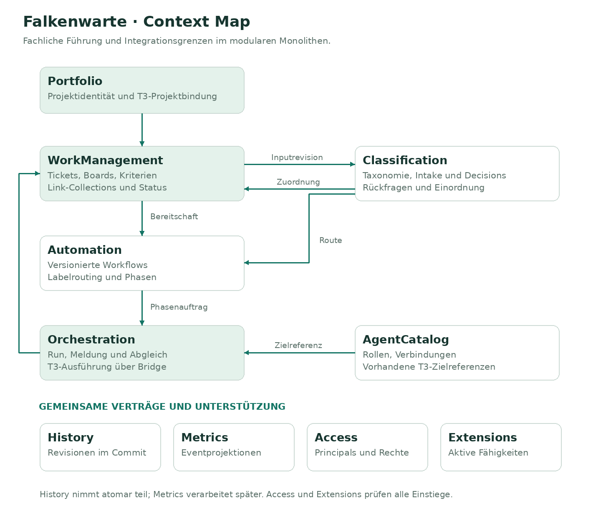

# Context Map und veröffentlichte Beziehungen

**Status:** Verbindlicher Fachvertrag aus Konzeptfassung 2.0. Der Umsetzungs- und Abnahmenachweis steht in [TRACEABILITY.md](../TRACEABILITY.md).

## Fachliche Richtung

Portfolio liefert Projektidentität und Scope. WorkManagement führt die Aufgaben. Classification bewertet Eingänge und schlägt zulässige Zuordnungen vor. Automation wählt eine versionierte Route und fordert Phasenarbeit von Orchestration an. Orchestration verwendet AgentCatalog für ein auflösbares T3-Ziel.

| Liefernder Context | Konsument | Vertrag und Abhängigkeit |
|---|---|---|
| Portfolio | WorkManagement, AgentCatalog, Automation | Projekt-ID, Aktivstatus, T3-Bindungsreferenz; keine Kopie der gesamten Projektverwaltung |
| WorkManagement | Classification | Unveränderliche Intake-/Ticketrevision und erforderliche Angaben |
| Classification | WorkManagement | Validierte Labelzuordnung, Herkunft und Handlungsbedarf über lokalen Application-Vertrag |
| Classification | Automation | Ausgewähltes Workflowlabel und konkrete Routingregelversion |
| WorkManagement | Automation | Fachliche Ereignisse über Bereitschaft, Änderungen und Abschluss |
| Automation | Orchestration | Versionierter Phasenauftrag, Abschlussregel und begrenzte Wiederholungsregel |
| AgentCatalog | Orchestration | Berechtigtes Profil, Verbindung und vorhandene T3-Zielreferenz |
| Orchestration | WorkManagement, Automation | Zugeordnete Meldung, Run-Ausgang und mögliche Folgephase |
| Ändernder Context | History | Redigierter Snapshot als Teilnehmer derselben DBAL-Transaktion |
| Ändernder Context | Metrics | Versioniertes Domain Event über Outbox; spätere, wiederaufbaubare Projektion |
| Access, Extensions | Öffentliche Einstiegspunkte | Projekt-/Principalrechte und aktive Capability-Gates |

Die zwei Richtungen zwischen Aufgabe und Klassifikation sind ausdrücklich unterschiedliche Application-Verträge. Ein KI-Aufruf erfolgt niemals als verschachtelte Datenbankmutation. Eine Eventschleife wird nicht aus bloßem „Label geändert“ erneut gestartet; nur eine ausdrücklich neue Intake-/Reclassify-Aktion löst eine Bewertung aus.

## Externe Grenzen

| Grenze | Eigentümer in Falkenwarte | Abstraktion und Schutz vor fremdem Modell |
|---|---|---|
| T3 MCP | Orchestration-Infrastruktur | `AgentExecutionBridge` normalisiert Fähigkeiten, Launchbelege und Beobachtungen. T3-Statuswerte werden nicht ungeprüft zu Domainzuständen. |
| OpenAI Decisions über Symfony AI | Classification-Infrastruktur | `DecisionGateway` liefert eigene Assessment-DTOs. Provider-Question- und Answerklassen bleiben im Adapter. |
| Mercure | Delivery-Infrastruktur | `UiChangePublisher` sendet Ressourcenhinweise nach Commit. Der Hub besitzt keine Fachzustände. |
| Externe Issue-/PR-URLs | WorkManagement | Eine gespeicherte Linkreferenz ohne API-Client, Fernabfrage oder Statusprojektion. |

Die Integrationsadapter sind Anti-Corruption Layers: Sie übersetzen das fremde Datenmodell, statt es in die Domain zu übernehmen. Ein Wechsel der technischen Bridge darf keine neue Bedeutung für „Ticket abgeschlossen“ erzeugen.

## Änderungsregel

Eine neue Pfeilrichtung in dieser Map benötigt einen veröffentlichten Vertrag und einen dokumentierten Datenbesitzer. Ein neues externes System benötigt außerdem eine eigene Scope-Entscheidung. Ein Plugin darf nicht durch einen direkten SQL-Zugriff eine nicht dokumentierte Context-Beziehung schaffen.

Die bearbeitbare Diagrammquelle liegt unter `diagrams/context-map.mmd`. Die PNG-Fassung dient PDF und statischer Dokumentation. Bei Änderungen werden beide gemeinsam aktualisiert.
