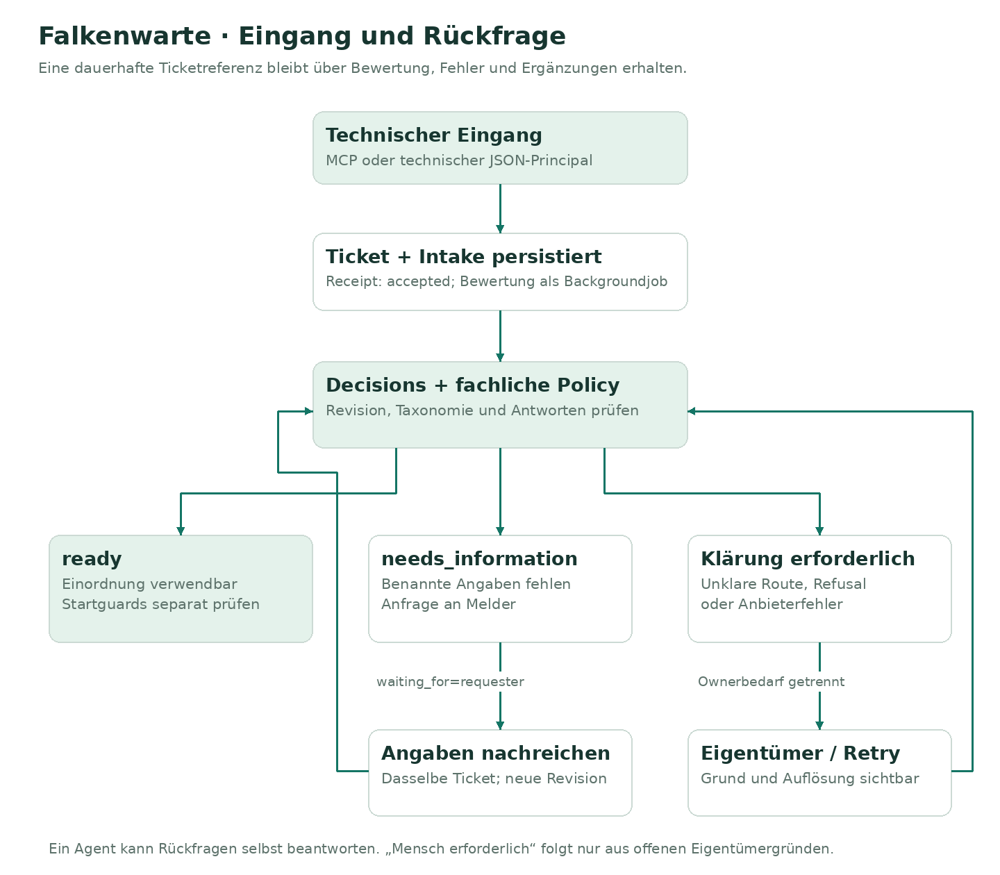

# Lebenszyklen und Übergänge

**Status:** Verbindlicher Fachvertrag aus Konzeptfassung 2.0. Der Umsetzungs- und Abnahmenachweis steht in [TRACEABILITY.md](../TRACEABILITY.md).

## 1. Mehrere unabhängige Zustände

Den fachlichen Übergängen sind im [Ereigniskatalog](EVENTS.md) die zugehörigen Verträge zugeordnet. Für Intake v1 legen das [Eingangsreceipt](../../contracts/schemas/ticket-receipt.schema.json) und der [Klassifikationsnachweis](../../contracts/schemas/classification-record.schema.json) die gespeicherten Aussagen fest.

Ticketstatus, Intake, Run, Action, menschliche Aufmerksamkeit und Pluginzustand beschreiben verschiedene Dinge. Ein Drag-and-drop im Board verändert den Taskstatus. Es beendet keinen Agentlauf, erfüllt keine Rückfrage und erteilt keine menschliche Freigabe.

Alle Übergänge tragen Akteur, Zeitpunkt, erwartete Version und Ursache. Ein abgewiesener Übergang liefert einen nachvollziehbaren fachlichen Konflikt. Ein unklarer externer Ausgang wird nicht allein durch Zeitablauf zu Erfolg.

## 2. Ticketstatus

| Von | Nach | Voraussetzung und Wirkung |
|---|---|---|
| neu | backlog | Task gespeichert; technischer Eingang erhält zusätzlich einen Intake. |
| backlog | ready | Erforderliche Angaben und zulässige Route vorhanden; bei Pflichtklassifikation muss eine gültige Einordnung oder begründete Eigentümerentscheidung vorliegen. |
| ready | active | Menschliche Bearbeitung oder ausdrücklich gestartete Workflowphase; passende WIP-Grenzen sind frei. |
| active | review | Ergebnis liegt als Meldung vor; die konfigurierte Taskpolicy verlangt eine Entscheidung oder Reviewphase. |
| active / review | done | TaskCompletionPolicy ist für die aktuelle Revision erfüllt. Menschliche Arbeit benötigt keinen erfundenen Run. |
| beliebig offen | cancelled | Begründete Aufgabeentscheidung. Ein laufender externer Run benötigt einen gesonderten Abbruch-/Abgleichpfad. |
| done / cancelled | backlog / ready | Explizite Wiedereröffnung mit Grund und neuer Revision; alte Abschlussereignisse bleiben erhalten. |

Weitere Rückbewegungen sind projektbezogen konfigurierbar, müssen aber dieselben Guards erfüllen. Ein eigener Statusname ändert die Bedeutung seiner Kategorie nicht. Offene Runs und Entscheidungen werden bei einer Wiedereröffnung nicht unsichtbar entfernt.

## 3. Intake und Rückfragen

`assessment_status` beschreibt den technischen Bewertungsjob: `queued`, `running`, `completed`, `stale` oder `failed`. `outcome` beschreibt sein fachliches Ergebnis. `waiting_for` beschreibt den nächsten zuständigen Akteur. Diese drei Dimensionen werden separat gespeichert.

| Outcome | Bedeutung | Nächster zulässiger Schritt |
|---|---|---|
| accepted | Eingang ist dauerhaft gespeichert; Bewertung ist noch nicht fertig. | Status abfragen; Worker verarbeitet denselben Intake. |
| ready | Aktueller Eingabestand hat ausreichende Einordnung und Angaben. | Explizite Workflow-/Startregel darf prüfen, ob Arbeit beginnen kann. |
| needs_information | Benannte Angaben fehlen. | `tasks_supply_information` mit Antworten zu den Feldschlüsseln; erneute Bewertung derselben Aufgabe. |
| needs_human_decision | Mehrdeutige Route oder ausdrücklich nötige Eigentümerentscheidung. | Mensch wählt begründet eine zulässige Route oder korrigiert den Eingang. |
| classification_unavailable | Bewertung konnte nicht verlässlich abgeschlossen werden. | Begrenzter Retry beziehungsweise sichtbare Eigentümerklärung; kein automatischer Start. |

Eine offene Frage an den technischen Melder setzt `waiting_for=requester`. Die UI zeigt „Rückfrage an Agent“. `waiting_for=owner` setzt einen offenen menschlichen Handlungsgrund. Wird der Melder unerreichbar, läuft eine begrenzte Klärungsrunde aus oder ist die Frage ausdrücklich menschlich zu beantworten, wird die Eskalation mit Grund historisiert.

Kommt eine Antwort für eine inzwischen veränderte Ticketrevision zurück, wird sie als veraltet gespeichert und nicht blind angewendet. Eine neue Bewertung fixiert erneut Input, Taxonomie und Regeln. Ein manueller Labelwechsel überschreibt nicht still die Herkunft einer bereits angewandten Klassifikation.

Eine neue Bewertung ersetzt erst beim fachlichen Commit die offenen `source=intake`-Gründe älterer Intake-Generationen derselben Aufgabe; ein neu notwendiger Grund wird danach für das aktuelle Ergebnis geöffnet. Während der neuen Bewertung bleiben die bisherigen Gründe sichtbar, und Gründe aus Run-, Approval- oder Authentifizierungsquellen bleiben unabhängig offen. Ein Ergebnis, dessen fixierte Revision oder Konfigurationsversion nicht mehr aktuell ist, bleibt als nicht angewandter Klassifikationsnachweis erhalten; der neueste Intake bewertet den aktuellen Stand erneut.

## 4. Run

| Zustand | Bedeutung | Typische zulässige Fortsetzung |
|---|---|---|
| queued | Auftrag und Startidentität gespeichert | dispatching, cancelled |
| dispatching | Start wird extern zugestellt | running; bei unklarer Annahme reconciling; bei Zugangsproblem auth_blocked |
| running | Externe Arbeit ist als aktiv beobachtet | waiting_input, result_reported, cancel_requested, reconciling |
| waiting_input | Konkrete Frage/Eingabe steht aus | running nach zugeordneter Antwort; cancel_requested |
| auth_blocked | Benötigte T3-Autorisierung fehlt | reconciling nach Wiederherstellung, nicht blinder neuer Start |
| reconciling | Externer Zustand wird aufgeklärt | Passender beobachteter Zustand oder begründete Eigentümerentscheidung |
| cancel_requested | Abbruch wurde angefordert | cancelled nach Beleg; weiterhin running/reconciling bei ausstehender Bestätigung |
| result_reported | Zugeordnete Agentmeldung liegt vor | verifying, waiting_input oder reconciling |
| verifying | Zuordnung, Berichtsvollständigkeit und Phasenpolicy werden geprüft | succeeded, failed, waiting_input oder nötige menschliche Entscheidung |
| succeeded | RunCompletionPolicy der Phase erfüllt | Folgephase darf angefordert werden; Taskabschluss ist gesondert. |
| failed | Ausdrücklich gescheiterter Run | Begrenzte neue fachliche Reparaturrunde oder Eigentümerentscheidung |
| cancelled | Abbruch ausreichend geklärt | Kein automatischer Neustart desselben Auftrags |
| abandoned | Lokale Weiterbearbeitung ausdrücklich aufgegeben | Ungeklärter externer Slot bleibt quarantänisiert, bis eine separate Aufklärung vorliegt. |

Die Tabelle nennt die Hauptwege; der exakte Transition-Guard prüft auch gespeicherte T3-IDs, Versuch, Snapshot und Policy. Das Wort `verifying` bezeichnet keine technische Code- oder Testprüfung. Die UI darf hierfür „Meldung prüfen“ verwenden.

Ein früher Agentbericht kann eintreffen, bevor die Launchantwort gespeichert ist. Er wird mit Run-ID und Korrelationsdaten als Kandidat abgelegt und später zugeordnet. Er setzt nicht eigenmächtig den Launch auf erfolgreich. Bei Authentifizierungswechsel wird ein unsicherer Dispatch im bisherigen Idempotenznamespace aufgeklärt.

## 5. Menschliche Entscheidung und Attention

Ein Approval durchläuft `pending` → `approved` oder `rejected`. Ändern sich relevante Ticketrevision, Versuch oder Ergebnisdigest, wird ein nicht mehr passendes Approval `invalidated`. Eine ältere Zustimmung darf nicht ein neues Ergebnis freigeben.

Offene Gründe wie `routing_ambiguous`, `approval_pending`, `agent_question`, `auth_required` oder `reconciliation_required` besitzen jeweils eine passende Auflösungsaktion. `human_attention.required` ist genau dann wahr, wenn mindestens ein an den Eigentümer gerichteter Grund offen ist. Das Auflösen eines Grunds löscht andere Gründe nicht.

Ein Attentionlabel kann umbenannt und umgefärbt werden. Seine fachliche Bedeutung und Systembindung bleiben stabil. Ein anderes Systemlabel kann eine Rückfrage an den Agenten anzeigen, ohne human_attention.required zu setzen. Das direkte Schreiben eines Labelarrays darf keinen offenen Grund entfernen.

## 6. Action und Lieferung

Eine Action durchläuft `accepted` → `started` → `succeeded` oder `failed`. Ihr Erfolg bezeichnet den erfolgreichen lokalen Anwendungsfall. Eine Action zum Anfordern eines Runs kann erfolgreich sein, während der Run erst `queued` ist. Der Client liest die verlinkten Ressourcen, statt aus einem HTTP-202 einen fertigen Agentauftrag abzuleiten.

Jede externe Lieferung besitzt eigenen Zustand, Attempts, nächste Fälligkeit und letzte Fehlerklasse. T3-Dispatch, Decisions-Aufruf und Mercure-Publish werden nicht durch ein gemeinsames „gesendet“-Bit vertreten. Outbox-Duplikate werden lokal beziehungsweise anhand der passenden externen Idempotenzstrategie entschärft.

## 7. Plugin

Die reguläre Folge ist `discovered` → `installed_disabled` → `enabling` → `enabled` → `draining` → `disabled` → `uninstall_pending` → `removed`. Fehlgeschlagene Prüfung oder Migration wird als `failed` mit Wiederaufnahmeinformation sichtbar.

`draining` sperrt neue Arbeit, erlaubt aber die zur Klärung vorhandener Arbeit nötigen Beobachtungen. Ein Paket mit abhängigen aktiven Plugins oder ungeklärter externer Ausführung ist nicht entfernbar. Neuer ausführbarer Code wird über ein neues Image installiert; Aktivierung vorhandener Beiträge geschieht zur Laufzeit.

## 8. Projekt und Restore

Ein Projekt ist aktiv oder archiviert. Archivierung bewahrt Geschichte und offene externe Referenzen. Eine Wiederaktivierung erzeugt eine neue Revision und stellt nicht automatisch frühere Zeitpläne scharf.

Nach Restore wechselt die Installation in einen Wiederherstellungsmodus: Daten-/Paketstand prüfen, bekannte und mögliche spätere externe T3-Arbeit inventarisieren, ungeklärte Slots sperren, anschließend automatische Starts ausdrücklich wieder freigeben. Ein Datenbankbackup kann externe Arbeit nicht zurückspulen.
